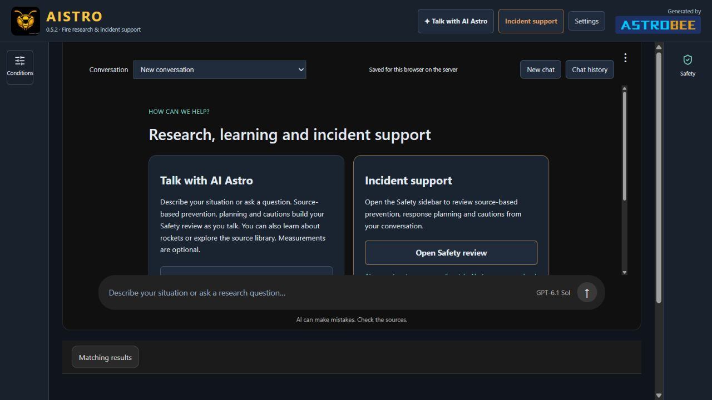

# AISTRO · Flame in Freefall

**Explore combustion research, compare reported conditions, and follow an answer back to its source.**

An independent student hackathon project for the **2026 NASA Space Apps Challenge**, developed by the AISTRO team. The application brings NASA Physical Sciences Informatics (PSI) research, material references, document reading, and an AI research conversation into one workspace.

**[Open the live application](https://aistro-flame-freefall.duckdns.org)** · **[Download Windows portable 0.5.2](https://github.com/ahmet123taha/aistro-flame-in-freefall/releases/download/v0.5.2/SpaceApps1-0.5.2.zip)** · **[Get the dataset](data/README.md)** · **[Browse source](app/)** · **[Space Apps project](https://www.spaceappschallenge.org/2026/find-a-team/aistro/?tab=project)**



## Start here

| You want to… | Go to… |
|---|---|
| Try the project without installing software | [Live application](https://aistro-flame-freefall.duckdns.org), no sign-in required |
| Run it on Windows | [Portable release](https://github.com/ahmet123taha/aistro-flame-in-freefall/releases/tag/v0.5.2) and the [data installation guide](data/README.md) |
| Inspect or reproduce the implementation | [Source](app/), [architecture](docs/architecture.md), and [reproducibility](docs/reproducibility.md) |
| Check where the information comes from | [Data provenance and distribution](data/README.md), [third-party notices](THIRD_PARTY_NOTICES.md), and the original-source links shown in the app |
| Review how AI was used | [AI disclosure](docs/ai-disclosure.md) |

## What it does

- **Start with a question.** Describe a research scenario; add material, gravity, gas composition, pressure, temperature, or flow details when useful. Unknown conditions can stay unknown.
- **Read the evidence.** Open original reports and available tables or figures alongside the conversation. Source references retain file locations and, where indexed, page, sheet, or row anchors.
- **Compare reported conditions.** Inspect usable measurements and coverage instead of treating missing values as zero. Material applicability and numerical proximity remain separate from an AI interpretation.
- **Explore reviewed graphs.** Inspect supported table-based plots and published-equation curves with their source assumptions. Reconstructed curves are not newly measured experiments.
- **Review source-supported safety considerations.** The Safety panel organizes relevant findings and cautions. In version 0.5.2, Incident support opens this panel; it does not start a voice call or emergency service.

## Run the portable application

1. Download and extract **[SpaceApps1-0.5.2.zip](https://github.com/ahmet123taha/aistro-flame-in-freefall/releases/download/v0.5.2/SpaceApps1-0.5.2.zip)**.
2. Follow the **[dataset guide](data/README.md)**. Place the resulting `Veri_Seti` folder **beside `SpaceApps1.exe`**; retain its subfolder names and pinned indexes.
3. Double-click `SpaceApps1.exe`. A local server starts on a free loopback port and opens your browser. **No Node.js or Rust installation is required.**
4. For AI responses, enter your own OpenAI API key in **Settings**. It is stored with Windows account encryption, outside the application folder. Provider access and usage charges belong to that API account.

```text
SpaceApps1/
├── SpaceApps1.exe
├── START_HERE.txt
├── THIRD_PARTY_NOTICES.txt
└── Veri_Seti/
    ├── DATASET.json
    └── … data and versioned indexes
Developer Patch/
└── … source, engineering records, and release evidence
```

The application ZIP and dataset are separate downloads. Local source browsing and numerical comparison do not require an AI response; AI interpretation requires a configured, available provider. An absent or incomplete dataset limits the evidence available to either workflow.

## Run from source

Use **Node.js 20 or newer** and install the locked dependencies:

```powershell
git clone https://github.com/ahmet123taha/aistro-flame-in-freefall.git
cd aistro-flame-in-freefall/app
npm ci

# Choose the parent directory that contains your Veri_Seti folder.
$env:SPACEAPPS_DATA_ROOT = 'C:\AistroData'
$env:SPACEAPPS_STATE_DIR = Join-Path $env:LOCALAPPDATA 'AistroSourceDemo'
$env:PUBLIC_ORIGIN = 'http://127.0.0.1:8770'
$env:PORT = '8770'
npm run start:hosted
```

Open **http://127.0.0.1:8770**. To enable AI, supply `OPENAI_API_KEY` privately in the server process environment before starting; never put it in the repository. The current configured research model is `gpt-6.1-sol`. This entry point requires the compatible dataset and listens on loopback; public hosting needs a reverse proxy. See [reproducibility](docs/reproducibility.md) for configuration and verification details.

## Data and evidence boundaries

NASA PSI experimental records are the main research foundation. Supplementary material references are identified separately. The app retrieves selected indexed passages and reviewed numerical records; it does **not** load every raw file into an AI context or automatically interpret every report.

The [dataset guide](data/README.md) describes the published contents, installation, provenance, and redistribution limits. Original documents and data keep their own rights and attribution. This repository's software license does not relicense those sources.

**Numerical similarity is a retrieval aid, not a fire probability or proof of equivalent physical behavior.** AI answers can be incomplete or wrong. This prototype is for research and learning, not operational fire-safety decisions, emergency dispatch, or an approved emergency procedure.

## Release and verification

The current public snapshot is **0.5.2**. `app/` preserves the matching source from the sealed release; some internal documents describe historical versions. The root documentation describes the current distribution.

Recorded 0.5.2 Linux verification: **609 tests passed, 1 skipped, 0 failed**, with mocked provider interactions; **219 JavaScript files** passed syntax checks. These checks do not establish real-model scientific accuracy or Windows execution. This publication does not claim a new Windows runtime test. Exact archive and executable hashes are in [reproducibility](docs/reproducibility.md).

## Open development

Original project code and this repository's original documentation are released under **[Apache License 2.0](LICENSE)**. Dependencies, source datasets, scientific publications, figures, fonts, and branding retain their respective terms; see [NOTICE](NOTICE), [third-party notices](THIRD_PARTY_NOTICES.md), and [data documentation](data/README.md).

Contributions are welcome through [issues and pull requests](CONTRIBUTING.md). To cite this software, use [CITATION.cff](CITATION.cff) and cite the underlying scientific sources separately.

**Independent student hackathon project. Not affiliated with, endorsed by, or certified by NASA or its Space Agency Partners.** NPR 7150.2D Class C is an incomplete engineering target in the historical records, not a certification or formal NASA classification.
