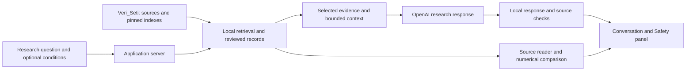

# How the workspace works

AISTRO 0.5.2 combines a browser interface, a Node.js server, a local evidence corpus, and an optional external research model. The Windows application embeds the server and interface in a Node single executable. Hosted mode runs the same application behind a reverse proxy.

## Evidence before interpretation

[`lib/dataset.mjs`](../app/lib/dataset.mjs) loads the compatible `Veri_Seti` package and its indexes. Reviewed source dependencies are checked against expected hashes. Available text and numerical records are retrieved locally; the entire raw dataset is not sent to the model.

The source-content index supports passage discovery. Numerical comparison uses separately reviewed fields and explicit units. These are different evidence paths: finding a sentence does not establish a comparable measurement, and a broad material-family match does not establish identical specimens.

The model receives selected source material, the current question, known conditions, and bounded conversation context. [`lib/openai.mjs`](../app/lib/openai.mjs) uses the OpenAI Responses API. Application checks resolve references and validate structured outputs before accepting source briefings or recommendation updates. There is no enabled model web-search tool, automatic retry, or silent provider fallback in this release.

## Two ways to run

| Mode | Entry point | Data and state |
|---|---|---|
| Windows portable | [`portable.mjs`](../app/portable.mjs), bundled as `SpaceApps1.exe` | `Veri_Seti` beside the EXE; account-encrypted key and local history outside the package |
| Hosted or local source server | [`hosted.mjs`](../app/hosted.mjs) | Dataset location from environment; separate writable state directory; anonymous per-browser sessions |

The hosted listener binds to `127.0.0.1`. A public deployment supplies its exact origin and forwards traffic through a reverse proxy. The provider key remains server-side. The desktop opens a random loopback port and stores its OpenAI key through Windows DPAPI.

## User-facing boundaries

- Original-source reading and supported local comparisons remain distinct from AI interpretation.
- Missing evidence stays unassessed; it is not a zero measurement.
- Published-equation curves and reconstructed tables remain labelled calculations or reconstructions.
- Numerical proximity is not fire probability, physical equivalence, or a calibrated safety threshold.
- The 0.5.2 Incident support control opens the existing Safety panel. Separate voice/text incident sessions and microphone capture are retired.

Source traceability makes review possible; it does not establish independent scientific validation or approval for operational use. See [AI disclosure](ai-disclosure.md) and [reproducibility](reproducibility.md).
